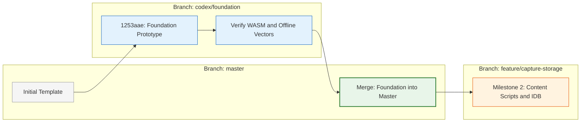

# Project Progress & Roadmap

## 🏆 Completed Work

### 1. Project Conception & Academic Proposal
- Finalized comprehensive problem statement, target personas, technical pipeline, and risk assessments.
- Authored the formal academic Project Proposal (`meridian_proposal.pdf` and `main.tex`).
- Established software requirements, system boundaries, and architectural diagrams (Use Case, Context DFD Level 0, Level 1, and Level 2 DFDs).

### 2. Milestone 1: Foundation Prototype Implementation
Developed and verified the core extension foundation within `code/extension/`:

```text
code/extension/
├── manifest.json              # Chromium Manifest V3 extension configuration
├── package.json               # Vite + React + Transformers.js dependencies
├── assets.lock.json           # SHA-256 Checksums for pinned all-MiniLM-L6-v2 assets
├── src/
│   ├── background/            # Background service worker (background.ts)
│   ├── embedding/             # Worker (worker.ts) & client manager (client.ts)
│   ├── shared/                # Shared TypeScript data contracts (contracts.ts)
│   └── ui/                    # React diagnostic UI (App.tsx & components)
└── dist/                      # Packaged production extension bundle
```

### 3. Technical Verification & Benchmarks
- Verified off-main-thread execution using a dedicated Web Worker running `@huggingface/transformers` via WebAssembly (WASM).
- Confirmed generation of **real 384-dimensional dense vectors** with unit L2 normalization ($pprox 1.000000$).
- Validated **100% offline execution** with physical network interfaces disabled.
- Proved semantic separation:
  - Related test pair cosine similarity: **$pprox +0.589$**
  - Unrelated test pair cosine similarity: **$pprox -0.069$**
  - Observed cold model load latency: **$pprox 360	ext{ ms}$**
  - Observed warm embedding latency: **$pprox 7	ext{--}8	ext{ ms}$**

### 4. Repository Integration Status
- Foundation implementation is committed on branch:
  ```text
  origin/codex/foundation (Commit: 1253aae)
  ```
- Local weekly journals and Gantt charts are synchronized through Week 11.

---

## 🚧 Current Limitations & Incomplete Work

The current system represents a functional **Level 0 Foundation Prototype** designed for architectural validation. The following capabilities are planned for upcoming milestones and are **not yet implemented**:

- [ ] Active-tab webpage extraction (`Readability.js` content script).
- [ ] Structured extraction of headings, tables, and fenced code blocks.
- [ ] Token-based overlapping chunking (256w / 50o).
- [ ] Duplicate tab detection and update prompts.
- [ ] Tiered on-device persistence (IndexedDB schema & OPFS binary storage).
- [ ] Local PDF (`pdf.js`) and Markdown file import pipelines.
- [ ] Local cosine similarity search across multi-item collections.
- [ ] Interactive 2D spatial canvas rendering (Konva.js / HTML5 Canvas).
- [ ] UMAP high-dimensional projection worker and collision relaxation.
- [ ] Card pinning, drag-and-drop movement, and persistent layout coordinates.
- [ ] Automated 7-day storage lifecycle cleanup.
- [ ] Portable workspace export/import (JSON & standalone HTML viewer).
- [ ] Chrome Web Store publication.

---

## ⚡ Immediate Project Action



1. **Review and Merge Foundation Branch:** Merge `codex/foundation` into default `master`.
2. **Standardize Teammate Workspaces:** Ensure all team members pull the merged `master` and initialize local assets using `npm run setup`.
3. **Branching Strategy:** Establish dedicated feature branches for Milestone 2 work (`feature/capture-content-script`, `feature/indexeddb-storage`).

---

## 🗺️ Multi-Milestone Development Roadmap & Gantt Timeline

> [!NOTE] Detailed Gantt Chart Deliverables
> The project maintains a complete, synchronized 11-week Gantt schedule accessible across multiple formats:
> 
> - **Excel Spreadsheet (`.xlsx`)**: [`docs/GANTT-Chart/GANTT-Chart.xlsx`](../GANTT-Chart/GANTT-Chart.xlsx) (Fully styled OpenXML with calendar columns)
> - **Printable / Numbers PDF**: [`docs/GANTT-Chart/GANTT-Chart.pdf`](../GANTT-Chart/GANTT-Chart.pdf) (3-page landscape vector layout)
> - **Interactive HTML Viewer**: [`docs/GANTT-Chart/GANTT-Chart.html`](../GANTT-Chart/GANTT-Chart.html) (Live filtering by member)
> - **Universal Data (`.csv`)**: [`docs/GANTT-Chart/GANTT-Chart.csv`](../GANTT-Chart/GANTT-Chart.csv)

```mermaid
gantt
    title Meridian Spatial Cartographer - Milestone Timeline (Weeks 1 to 11)
    dateFormat YYYY-MM-DD
    axisFormat %b %d
    todayMarker stroke-width:2px,stroke:#e65100,opacity:0.7

    section Inception & Modeling
    W1: Team Formation & Problem Id    :done, w1, 2026-08-05, 2026-08-11
    W2: Proposal & Requirements       :done, w2, 2026-08-12, 2026-08-18
    W3: Architectural Diagrams (DFD)  :done, w3, 2026-08-19, 2026-08-25
    W4: Detailed Design & Refinement  :done, w4, 2026-08-26, 2026-09-01

    section Foundation & Evaluation
    W5: Level 0 Foundation Prototype  :done, w5, 2026-09-02, 2026-09-08
    W6: Activity Diagrams & Report    :done, w6, 2026-09-09, 2026-09-15
    W7: Mid-Sem Evaluation & Defense  :done, w7, 2026-09-16, 2026-09-22
    W8: Mid-Sem Examination Period    :done, w8, 2026-09-23, 2026-10-07

    section Active Architecture & Design
    W9: Ingestion & Storage Planning  :active, w9, 2026-10-07, 2026-10-13
    W10: Canvas Layout & Retrieval    :active, w10, 2026-10-14, 2026-10-20
    W11: Class, Sequence & Redesign   :active, w11, 2026-10-21, 2026-10-27

    section Upcoming Implementation
    Milestone 2 - Capture & Persistence :crit, m2, 2026-10-28, 2026-11-10
    Milestone 3 - Spatial Canvas & UMAP :crit, m3, 2026-11-11, 2026-11-24
```

### 📋 Phase Progress Summary (Weeks 1 to 11)

| Phase | Timeline | Primary Focus | Assignees | Status & Completion |
|---|---|---|---|:---:|
| **Phase 1: Team Formation & Problem Identification** | Aug 5 – Aug 11 | Problem space exploration, concept formulation | Team | **100% Completed** |
| **Phase 2: Project Proposal & Requirements Analysis** | Aug 12 – Aug 18 | Academic proposal, user interaction & DFD scope | Rahul, Jyotsna, Bisman | **100% Completed** |
| **Phase 3: Architectural Modeling & Initial Diagrams** | Aug 19 – Aug 25 | Level 0/1/2 DFDs, Use Case diagram, initial deck | Rahul, Jyotsna, Bisman | **100% Completed** |
| **Phase 4: Detailed Design & Refinement** | Aug 26 – Sep 1 | DFD refinements, presentation readiness | Rahul, Jyotsna, Bisman | **100% Completed** |
| **Phase 5: Level 0 Foundation Prototype** | Sep 2 – Sep 8 | Manifest V3 setup, WASM Transformers.js pipeline | Rahul, Jyotsna, Bisman | **100% Completed** |
| **Phase 6: Activity Diagrams & Stage Report** | Sep 9 – Sep 15 | Swimlane modeling, ER schemas, prototype stage report | Rahul, Jyotsna, Bisman | **90% – 95% Completed** |
| **Phase 7: Mid-Semester Evaluation & Defense** | Sep 16 – Sep 22 | Live prototype demo, data flow defense, evaluator logs | Rahul, Jyotsna, Bisman | **90% – 95% Completed** |
| **Phase 8: Mid-Semester Examination Period** | Sep 23 – Oct 7 | Academic exams, prototype review retrospective | Team | **80% – 90% Completed** |
| **Phase 9: Ingestion & Storage Architecture Planning** | Oct 7 – Oct 13 | Readability DOM parsing, IndexedDB/OPFS schemas | Rahul, Jyotsna, Bisman | **75% – 85% Progress** |
| **Phase 10: Canvas Layout & Retrieval Planning** | Oct 14 – Oct 20 | UMAP projection worker, cosine SQ8, usability review | Rahul, Jyotsna, Bisman | **70% – 85% Progress** |
| **Phase 11: Class, Sequence & UX Redesign** | Oct 21 – Oct 27 | Class & Sequence modeling, OOP code, Canvas UI wireframes | Rahul, Jyotsna, Bisman | **75% – 90% Progress** |


### Milestone 2: Capture and Storage
- **Focus:** Active tab DOM extraction and client-side database persistence.
- **Deliverables:**
  - Content script injection with `Readability.js` DOM sanitization.
  - Extraction of structured headings, paragraphs, and code blocks.
  - Viewport screenshot capture via `chrome.tabs.captureVisibleTab`.
  - IndexedDB storage adapter storing `ExtractedDocument` and `CanvasItem` records.
  - OPFS binary store for WebP visual thumbnails.
  - Duplicate URL detection preventing redundant captures.
- **Acceptance Criteria:** A user can click Capture on an active webpage; the sanitized text and preview thumbnail persist in IndexedDB/OPFS across browser restarts.

### Milestone 3: Working Search Prototype
- **Focus:** First end-to-end user loop combining capture, embedding, and semantic search.
- **Deliverables:**
  - Basic interactive canvas rendering captured items as cards.
  - Real-time natural language query embedding in Web Worker.
  - In-memory cosine similarity ranking across stored vectors.
  - Visual card highlighting and direct link to reopen the original tab.
- **Acceptance Criteria:** A user saves multiple distinct articles and retrieves the relevant source using a conceptually related natural language query.

### Milestone 4: Deep Research Chunking
- **Focus:** Fine-grained document segmentation and multi-source ingestion.
- **Deliverables:**
  - Sliding-window tokenizer (256 tokens per window, 50-token overlap).
  - Deep Focus Mode generating passage-level vector arrays.
  - Local PDF paper import via `PDF.js` preserving page numbers.
  - Markdown note importer and manual code snippet creator.
  - Passage-level search inspector pinpointing the exact matching paragraph.
- **Acceptance Criteria:** A query successfully retrieves a specific paragraph embedded deep inside a multi-page research paper.

### Milestone 5: Semantic 2D Map
- **Focus:** Dynamic dimensionality reduction and visual clustering.
- **Deliverables:**
  - Dedicated layout Web Worker executing UMAP projection (384d $	o$ 2D).
  - Spring-force collision correction preventing card overlap.
  - Viewport culling algorithm ensuring $\ge 55	ext{--}60	ext{ FPS}$ during canvas pan/zoom.
  - Persistent $(x, y)$ coordinate saving and pinned card locks.
  - Explicit *Reorganize Map* action.
- **Acceptance Criteria:** Conceptually related research cards cluster into distinct visual neighbourhoods while canvas navigation remains fluid.

### Milestone 6: Product Completion
- **Focus:** Storage lifecycle policies, exports, and UI polish.
- **Deliverables:**
  - Automated 7-day storage purge for unpinned preview thumbnails.
  - Manual storage quota inspection and cleanup controls.
  - Versioned JSON workspace export and import with full coordinate fidelity.
  - Standalone HTML workspace viewer with sanitized, inert scripts.
- **Acceptance Criteria:** Exported workspace JSON bundles can be re-imported on another machine without loss of data or spatial layout.

### Milestone 7: Validation and Final Handover
- **Focus:** Academic reporting, performance benchmarks, and delivery.
- **Deliverables:**
  - Automated performance benchmarks measuring Search Retrieval Latency (SRL) and FPS.
  - Complete academic Prototype Stage and Final Stage Reports.
  - Reproducible build pipelines and continuous integration checks.
- **Acceptance Criteria:** Comprehensive project demonstration, verified benchmarks, and complete academic submission.

---

## 👥 Parallel Development Workstreams

To maximize velocity without merge conflicts, development is decoupled into distinct modules following `code/extension/HANDOFF.md`:

```text
+-----------------------------------------------------------------------------------+
| Foundation Lead (Rahul Dadwal)                                                    |
| - Manifest V3, Web Worker infrastructure, WASM build, shared contracts.ts        |
+-----------------------------------------+-----------------------------------------+
                                          |
        +---------------------------------+---------------------------------+
        |                                                                   |
        v                                                                   v
+------------------------------------+             +------------------------------------+
| Ingestion & Storage (Jyotsna)      |             | UI & Spatial Canvas (Bisman/Team)  |
| - src/extraction/ (Readability)    |             | - src/ui/ (Canvas & Cards)         |
| - IndexedDB / OPFS adapters        |             | - Konva.js rendering & layout      |
| - PDF.js & Markdown parsers        |             | - Presentation & documentation     |
+------------------------------------+             +------------------------------------+
```
